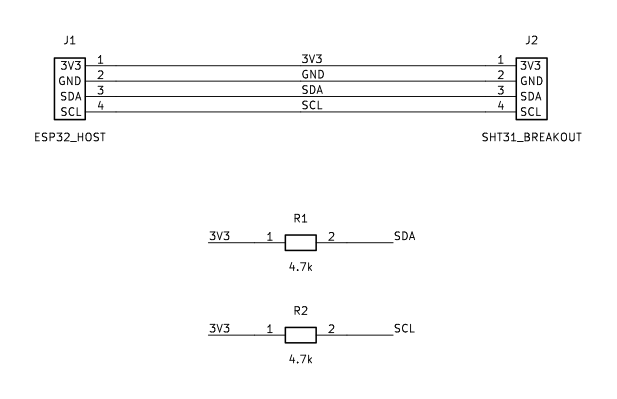
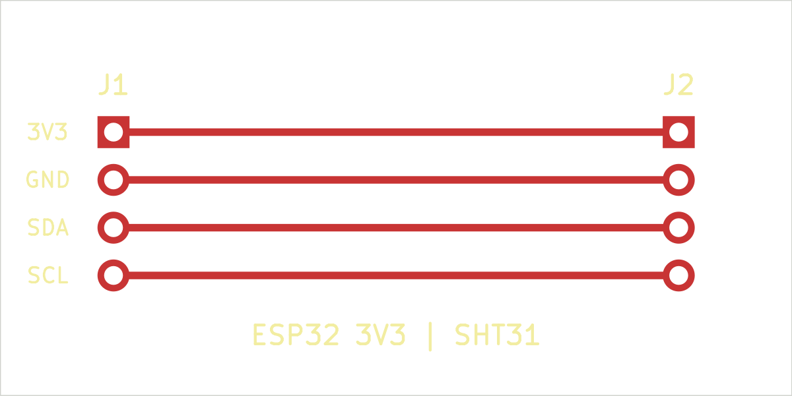

# Environmental sensor carrier

An SHT31 breakout carrier and a portable C driver. The board connects an ESP32-class 3.3 V host to an SHT31 breakout through 4-pin headers and adds 4.7 kΩ I²C pull-ups. The driver issues a single-shot high-repeatability measurement, validates both CRC bytes, and returns integer temperature and relative humidity. The portable driver and mock-bus tests run without hardware.

## Build and test

```sh
cmake -S . -B build
cmake --build build
ctest --test-dir build --output-on-failure
```

## Wiring and bring-up

See the editable KiCad [schematic](hardware/sensor_carrier.kicad_sch) and [PCB](hardware/sensor_carrier.kicad_pcb), plus [schematic preview](hardware/schematic_preview.png), [board preview](hardware/board_front.png), [wiring diagram](hardware/wiring.svg), and [BOM](hardware/BOM.csv). J1/J2: pin 1 3V3, 2 GND, 3 SDA, 4 SCL. Use **3.3 V only**. Confirm the SHT31 breakout's actual header order and whether it already contains I²C pull-ups before connecting or assembling this carrier. KiCad 9 ERC and PCB DRC (including schematic parity) each report zero violations; review connector fit and pin numbering before fabrication.





An ESP-IDF example is included in `esp32_demo/`, with GPIO21 SDA and GPIO22 SCL for a classic ESP32 development board. Build with `cd esp32_demo && idf.py set-target esp32 && idf.py build`. It waits 20 ms between the measurement command and readout; the sensor's [datasheet](https://sensirion.com/media/documents/213E6A3B/63A5A569/Datasheet_SHT3x_DIS.pdf) specifies a 15 ms maximum for this mode at 3.3 V. The API leaves timing to the caller so the driver can also run on another MCU. The ESP-IDF example has not been compiled here because ESP-IDF is not installed.

## Validation status

Host-side C tests cover the command, conversion, CRC error, I²C error, and invalid arguments. Physical PCB fabrication, electrical inspection, and live sensor measurements remain future work. The reports in `hardware/erc.txt`, `hardware/drc.txt`, and `hardware/parity.txt` record the KiCad checks.
